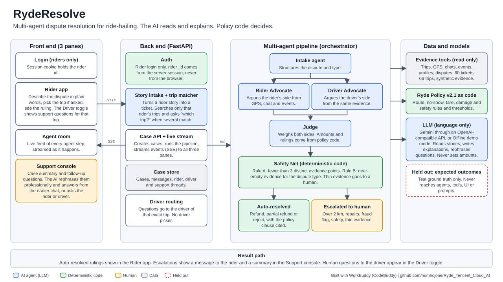

# RydeResolve

**Autonomous dispute resolution where every ruling is audited.**

RydeResolve is a multi-agent system that resolves ride-hailing disputes. A rider describes a problem in plain words. Specialised agents investigate it from GPS, chat and trip data, and the system either issues a policy-based ruling or escalates to a human agent with the case already summarised.

Built for the Tencent Cloud AI CAN DO IT Hackathon, Singapore 2026, Ryde challenge (Digital Native track).

The design rule behind everything: **the AI reads and explains, and policy code decides.** The language model never sets a refund amount or a ruling. Those come from Ryde Policy v2.1 implemented as code, so every outcome cites a clause and can be audited.

- [Live demo](#live-demo)
- [What it does](#what-it-does)
- [Architecture](#architecture)
- [How a case is resolved](#how-a-case-is-resolved)
- [The three-pane demo screen](#the-three-pane-demo-screen)
- [Test data: riders and their disputes](#test-data-riders-and-their-disputes)
- [Run it locally](#run-it-locally)
- [Deploy on Render](#deploy-on-render)
- [Testing](#testing)
- [Project structure](#project-structure)
- [API](#api)
- [Security and privacy design](#security-and-privacy-design)
- [Demo walkthrough](#demo-walkthrough)
- [Honest limits](#honest-limits)
- [Built with](#built-with)

## Live demo

- Live link: **[Try RydeResolve Live Demo](https://tencent-ryderesolve-demo.onrender.com)**
- The public demo runs in **Offline demo mode**: the same agent pipeline with scripted language, so results are repeatable and never hit an AI quota.
- **Live AI mode** uses Gemini for the language parts. It needs an API key and `LLM_MODE=llm` (see [Run it locally](#run-it-locally)).
- If the hosted site was idle it may take up to a minute to wake up. Cases are kept in memory and reset when the service restarts.
- Log in on the first page by choosing one of the demo riders (for example Wong Mei Ling). Only riders log in. Drivers do not.

## What it does

A rider logs in and describes a problem in their own words, for example "The driver took a really long route and I got charged more." RydeResolve then:

1. Turns the story into a structured ticket and finds the matching trip, **searching only that rider's own trips**. If several trips match, it asks "which trip?" with a picker.
2. Runs a pipeline of agents: Intake, Rider Advocate, Driver Advocate, Judge.
3. Applies Ryde Policy v2.1 in code to compute the ruling and any refund.
4. Runs a deterministic **Safety Net** that checks there is enough evidence to rule at all.
5. Either shows the ruling to the rider, or tells the rider that an agent will be in touch and hands a summarised case to the support console.

### Dispute categories handled

| Category | Examples | Typical outcome |
|---|---|---|
| Route deviation | Detour, extra distance charged | Refund of excess distance, partial refund, or rejection if traffic-justified; human approval if over 2 km |
| No-show charge | Driver cancelled, rider charged S$5 | Fee refunded, S$5 goodwill credit if the driver did not make contact, or rejected |
| Property damage | Cleaning fee, damage claim | Claim rejected and fee reversed if evidence fails policy; repairs go to a human |
| Safety incident | Threats, harassment | Never decided by AI. The system prepares a case file and escalates |

### Key features

- **Multi-agent pipeline** with distinct roles that argue both sides.
- **Deterministic policy engine** (Ryde Policy v2.1) so amounts and rulings are not guessed by a model.
- **Safety Net** that overrides to human review when evidence is thin.
- **Rider-only login and strict scoping.** A rider can only see and dispute their own trips. The rider id comes from the server session, never from the browser.
- **Trip picker** when several of a rider's trips match the story.
- **Three-pane live demo screen**: rider app, agent room and support console on one live case.
- **Support console**: summarised case, follow-up questions that the AI rephrases professionally, answers drawn from earlier chat when possible, otherwise the question is routed automatically to the rider or driver.
- **Driver toggle** on the rider pane. It shows the support questions for that exact trip. There is no driver picker, so a question cannot reach the wrong person.
- **Offline demo mode** that runs the same pipeline with no LLM.
- **Test ground truth held out** from agents, tools, the UI and prompts.

## Architecture



*Figure 1: RydeResolve system architecture showing the frontend, FastAPI backend, multi-agent pipeline, and supporting data and models.*

Four blocks, left to right:

- **Front end** (static HTML and JavaScript): login, rider app, agent room, support console, driver toggle.
- **Back end** (FastAPI): rider-only auth with a signed session cookie, story intake and trip matcher, case API with a live event stream (SSE), case store, driver routing.
- **Multi-agent pipeline** (orchestrator): Intake agent, Rider Advocate, Driver Advocate, Judge, then the deterministic Safety Net, ending in either **auto-resolved** or **escalated to human**.
- **Data and models**: read-only evidence tools (trips, GPS, chats, events, profiles, disputes), Ryde Policy v2.1 as code, the LLM (language only), and the held-out expected outcomes used only by tests.

### What the LLM does and does not do

| The LLM does | The LLM does not |
|---|---|
| Reads a rider's story and extracts the dispute type and trip clues | Set refund amounts |
| Lets the advocate agents argue from the evidence | Decide the policy ruling |
| Writes plain-language explanations of rulings | Rule on safety incidents |
| Rephrases support questions professionally | See the held-out expected outcomes |
| Answers support questions from earlier chat history | Override the Safety Net |

## How a case is resolved

```
Rider story
   |
   v
Story intake + trip matcher  (searches only this rider's trips; asks "which trip?" if several match)
   |
   v
Intake agent   ->  structures the dispute
   |
   +--> Rider Advocate   (argues the rider's side from GPS, chat, events)
   +--> Driver Advocate  (argues the driver's side from the same evidence)
   |
   v
Judge   (weighs both sides; amounts and rulings come from policy code)
   |
   v
Safety Net  (deterministic)  ->  thin evidence goes to a human
   |
   +--> Auto-resolved: refund / partial refund / reject, with the clause cited
   +--> Escalated: summarised case in the support console, message to the rider
```

### Ryde Policy v2.1 as implemented

| Area | Rule (clause) |
|---|---|
| Route deviation | Driver should inform the rider (1.2). Refund is the excess distance times S$0.80 per km (1.3), with a 1 km tolerance. A traffic justification is considered (1.4). |
| No-show | 5 minutes of free waiting (2.1). S$5 no-show fee (2.2). The driver must message and call (2.3). If the driver is late the fee is void (2.4). S$5 goodwill credit if the driver made no contact. |
| Fare dispute | Surge and fare rules (3.x). |
| Property damage | Evidence must be an in-app photo within 24 hours, linked to the trip (4.2). Cleaning is capped at S$50 (4.3). Repairs need a quote and a human. An unsupported claim is reversed (4.4). |
| Safety | The AI may only prepare a case file. A human decides (5.x). |
| Thresholds | A deviation over 2 km needs human approval. Repair claims go to a human. A fraud flag raises the confidence bar to 95% (section 6). Anything under 0.6 confidence goes to human review. |

### The Safety Net

A deterministic check that runs after the Judge. It can only push a case toward a human, never loosen a decision.

- **Rule A:** fewer than 3 distinct evidence points.
- **Rule B:** near-empty evidence sources for the dispute type (route: GPS and chat; no-show: GPS, chat and events; property: photos and chat).

### When the app escalates

Besides the Safety Net, a case goes to a human when it is a safety incident, a repair claim, a deviation over 2 km, the account has a fraud flag (95% confidence bar), or the confidence is below 0.6. When the app escalates a case, it still records the policy recommendation and the model assessment, so the human sees what the policy engine would have ruled.

## The three-pane demo screen

For demo purposes the screen is split into three panels that all work on one live case at the same time. This simulates how the front end and back end work for different users.

| Pane | Who it represents | What it shows |
|---|---|---|
| Left: Rider app | The rider | Chat, trip picker, the ruling, or "an agent will be in touch". A **Rider / Driver toggle** shows the support questions for that trip. |
| Middle: Agent room | The back end | Every agent step, streamed live. |
| Right: Support console | A human agent | A consolidated case summary. The human can ask follow-up questions. |

Support questions are rephrased by the AI so they are professional and free of spelling mistakes. If the AI has the answer from the earlier chat, it answers. If not, it asks the right person automatically (the rider, or the driver of that exact trip), and the human evaluates from there.

## Test data: riders and their disputes

The data is a **60-ticket synthetic dataset** in the organisers' file format, plus the earlier sample cases (DISP-001 to DISP-006) kept as regression tests. We created multiple rider accounts to show different kinds of disputes, test robustness and simulate real life.

- Each of the 6 riders has 10 tickets.
- Each rider has at least 2 tickets in every category.
- Ticket ids, riders and drivers follow the team's 60-ticket file. **The trip evidence (GPS, chat, events, fares) is synthetic.**
- Ruling "expected outcomes" are computed from Ryde Policy v2.1 by `scripts/build_dataset60.py`, independently of the app. They are used only by tests.
- Profile figures are as of 2026-10-15.

### Riders at a glance

| Rider | ID | Tickets | Route deviation | No-show | Property damage | Safety | Fraud flags |
|---|---|---|---|---|---|---|---|
| Wong Mei Ling | R-3312 | 10 | 3 | 3 | 2 | 2 | 0 |
| Sarah Tan | R-4521 | 10 | 2 | 3 | 3 | 2 | 0 |
| Ahmad Faiz | R-5120 | 10 | 2 | 2 | 3 | 3 | 0 |
| Chloe Ng | R-7001 | 10 | 3 | 3 | 2 | 2 | 0 |
| Daniel Lim | R-7823 | 10 | 2 | 2 | 3 | 3 | 1 |
| Priya Nair | R-9001 | 10 | 3 | 2 | 2 | 3 | 0 |

Ticket totals by category: Route deviation 15, No-show 15, Property damage 15, Safety 15.

### Drivers

| Driver | ID | Rating |
|---|---|---|
| Rajesh Kumar | D-1187 | 4.7 |
| Lim Wei Ming | D-2398 | 4.9 |
| Tan Boon Huat | D-3456 | 4.8 |
| Nur Aisyah | D-4410 | 4.6 |
| Hafiz Rahman | D-6021 | 4.2 |
| Ong Kai Wen | D-7002 | 4.7 |

### Each rider and the disputes they relate to

The "expected outcome" is our reading of Ryde Policy v2.1 for that ticket. "Rider upheld" means the rider's claim is accepted. Where the app escalates a case because of a safety incident, a repair claim, a deviation over 2 km, or a fraud flag, the outcome says so.

### Wong Mei Ling (R-3312)

Account age 413 days, 112 trips, rating 4.8, no fraud flags. Profile figures as of 2026-10-15.

| Ticket | Category | Trip (date, route) | Driver | Expected outcome |
|---|---|---|---|---|
| DISP-101 | Route deviation | 18 Sep, one-north to East Coast Park (TRIP-2026-2001) | Rajesh Kumar (D-1187) | Partial refund (S$2.48), needs human approval (deviation over 2 km) |
| DISP-102 | Route deviation | 20 Sep, Jurong East MRT to Raffles Place MRT (TRIP-2026-2002) | Lim Wei Ming (D-2398) | Rider upheld (S$1.36) |
| DISP-103 | No-show charge | 23 Sep, Clementi Mall to Ang Mo Kio Hub (TRIP-2026-2003) | Tan Boon Huat (D-3456) | Rider upheld (S$5.00) |
| DISP-104 | No-show charge | 26 Sep, Marina Bay Sands to Tiong Bahru Plaza (TRIP-2026-2004) | Nur Aisyah (D-4410) | Rejected |
| DISP-105 | Property damage | 28 Sep, Ang Mo Kio Hub to Orchard MRT (TRIP-2026-2005) | Hafiz Rahman (D-6021) | Rejected |
| DISP-106 | Property damage | 1 Oct, Bedok Mall to East Coast Park (TRIP-2026-2006) | Ong Kai Wen (D-7002) | Rider upheld (S$30.00) |
| DISP-107 | Safety incident | 4 Oct, Clementi Mall to Kallang Wave Mall (TRIP-2026-2007) | Rajesh Kumar (D-1187) | Escalated to human (safety incident) |
| DISP-108 | Safety incident | 6 Oct, Orchard Central to Holland Village (TRIP-2026-2008) | Lim Wei Ming (D-2398) | Escalated to human (safety incident) |
| DISP-109 | Route deviation | 9 Oct, Changi Business Park to East Coast Park (TRIP-2026-2009) | Tan Boon Huat (D-3456) | Escalated to human (thin evidence) |
| DISP-110 | No-show charge | 12 Oct, VivoCity to one-north (TRIP-2026-2010) | Nur Aisyah (D-4410) | Rider upheld (S$5.00 + S$5.00 goodwill) |

### Sarah Tan (R-4521)

Account age 573 days, 203 trips, rating 4.8, no fraud flags. Profile figures as of 2026-10-15.

| Ticket | Category | Trip (date, route) | Driver | Expected outcome |
|---|---|---|---|---|
| DISP-111 | Route deviation | 18 Sep, Tiong Bahru Plaza to Ang Mo Kio Hub (TRIP-2026-2011) | Hafiz Rahman (D-6021) | Partial refund (S$1.36) |
| DISP-112 | Route deviation | 21 Sep, Orchard MRT to Pasir Ris Mall (TRIP-2026-2012) | Ong Kai Wen (D-7002) | Rejected |
| DISP-113 | No-show charge | 23 Sep, Paya Lebar Quarter to Changi Airport T3 (TRIP-2026-2013) | Rajesh Kumar (D-1187) | Rider upheld (S$5.00 + S$5.00 goodwill) |
| DISP-114 | No-show charge | 26 Sep, HarbourFront Centre to Toa Payoh HDB Hub (TRIP-2026-2014) | Lim Wei Ming (D-2398) | Rider upheld (S$5.00) |
| DISP-115 | Property damage | 29 Sep, Bugis Junction to Woodlands MRT (TRIP-2026-2015) | Tan Boon Huat (D-3456) | Rider upheld (S$25.00) |
| DISP-116 | Property damage | 2 Oct, Bedok Mall to Changi Airport T3 (TRIP-2026-2016) | Nur Aisyah (D-4410) | Rider upheld (S$20.00) |
| DISP-117 | Safety incident | 4 Oct, Punggol Waterway Point to Kallang Wave Mall (TRIP-2026-2017) | Hafiz Rahman (D-6021) | Escalated to human (safety incident) |
| DISP-118 | Safety incident | 7 Oct, Ang Mo Kio Hub to Clementi Mall (TRIP-2026-2018) | Ong Kai Wen (D-7002) | Escalated to human (safety incident) |
| DISP-119 | Property damage | 10 Oct, Sengkang Compass One to Changi Business Park (TRIP-2026-2019) | Rajesh Kumar (D-1187) | Rejected, needs human approval (repair claim) |
| DISP-120 | No-show charge | 12 Oct, Tanjong Pagar Centre to Paya Lebar Quarter (TRIP-2026-2020) | Lim Wei Ming (D-2398) | Rider upheld (S$5.00) |

### Ahmad Faiz (R-5120)

Account age 330 days, 74 trips, rating 4.9, no fraud flags. Profile figures as of 2026-10-15.

| Ticket | Category | Trip (date, route) | Driver | Expected outcome |
|---|---|---|---|---|
| DISP-121 | Route deviation | 19 Sep, Buona Vista MRT to Toa Payoh HDB Hub (TRIP-2026-2021) | Tan Boon Huat (D-3456) | Rejected |
| DISP-122 | Route deviation | 21 Sep, East Coast Park to Buona Vista MRT (TRIP-2026-2022) | Nur Aisyah (D-4410) | Rejected, needs human approval (deviation over 2 km) |
| DISP-123 | No-show charge | 24 Sep, Novena Square to Changi Business Park (TRIP-2026-2023) | Hafiz Rahman (D-6021) | Escalated to human (thin evidence) |
| DISP-124 | No-show charge | 27 Sep, Kallang Wave Mall to Bishan Junction 8 (TRIP-2026-2024) | Ong Kai Wen (D-7002) | Rider upheld (S$5.00) |
| DISP-125 | Property damage | 29 Sep, Jurong East MRT to Orchard Central (TRIP-2026-2025) | Rajesh Kumar (D-1187) | Escalated to human (thin evidence) |
| DISP-126 | Property damage | 2 Oct, Pasir Ris Mall to Chinatown Point (TRIP-2026-2026) | Lim Wei Ming (D-2398) | Rejected, needs human approval (repair claim) |
| DISP-127 | Safety incident | 5 Oct, Bishan Junction 8 to Clarke Quay (TRIP-2026-2027) | Tan Boon Huat (D-3456) | Escalated to human (safety incident) |
| DISP-128 | Safety incident | 7 Oct, Bugis Junction to Sengkang Compass One (TRIP-2026-2028) | Nur Aisyah (D-4410) | Escalated to human (safety incident) |
| DISP-129 | Property damage | 10 Oct, HarbourFront Centre to Orchard Central (TRIP-2026-2029) | Hafiz Rahman (D-6021) | Rider upheld (S$30.00) |
| DISP-130 | Safety incident | 13 Oct, Lot One Choa Chu Kang to Sengkang Compass One (TRIP-2026-2030) | Ong Kai Wen (D-7002) | Escalated to human (safety incident) |

### Chloe Ng (R-7001)

Account age 38 days, 18 trips, rating 3.9, no fraud flags. Profile figures as of 2026-10-15.

| Ticket | Category | Trip (date, route) | Driver | Expected outcome |
|---|---|---|---|---|
| DISP-131 | Route deviation | 19 Sep, East Coast Park to Changi Business Park (TRIP-2026-2031) | Rajesh Kumar (D-1187) | Partial refund (S$1.36) |
| DISP-132 | Route deviation | 22 Sep, Punggol Waterway Point to Changi Business Park (TRIP-2026-2032) | Lim Wei Ming (D-2398) | Escalated to human (thin evidence) |
| DISP-133 | No-show charge | 24 Sep, Bishan Junction 8 to Novena Square (TRIP-2026-2033) | Tan Boon Huat (D-3456) | Rider upheld (S$5.00) |
| DISP-134 | No-show charge | 27 Sep, Ang Mo Kio Hub to Yishun Northpoint (TRIP-2026-2034) | Nur Aisyah (D-4410) | Escalated to human (thin evidence) |
| DISP-135 | Property damage | 30 Sep, Bedok Mall to Paya Lebar Quarter (TRIP-2026-2035) | Hafiz Rahman (D-6021) | Rejected |
| DISP-136 | Property damage | 3 Oct, Tampines Mall to NUS Kent Ridge (TRIP-2026-2036) | Ong Kai Wen (D-7002) | Rider upheld (S$30.00) |
| DISP-137 | Safety incident | 5 Oct, Novena Square to Clementi Mall (TRIP-2026-2037) | Rajesh Kumar (D-1187) | Escalated to human (safety incident) |
| DISP-138 | Safety incident | 8 Oct, Lot One Choa Chu Kang to Novena Square (TRIP-2026-2038) | Lim Wei Ming (D-2398) | Escalated to human (safety incident) |
| DISP-139 | Route deviation | 11 Oct, one-north to Changi Business Park (TRIP-2026-2039) | Tan Boon Huat (D-3456) | Partial refund (S$1.04) |
| DISP-140 | No-show charge | 13 Oct, Great World to Tampines Mall (TRIP-2026-2040) | Nur Aisyah (D-4410) | Escalated to human (thin evidence) |

### Daniel Lim (R-7823)

Account age 242 days, 50 trips, rating 3.9, 1 fraud flag on the account (raises the confidence bar to 95%, so the app often escalates these tickets). Profile figures as of 2026-10-15.

| Ticket | Category | Trip (date, route) | Driver | Expected outcome |
|---|---|---|---|---|
| DISP-141 | Route deviation | 20 Sep, Holland Village to Suntec City (TRIP-2026-2041) | Hafiz Rahman (D-6021) | Rider upheld (S$1.04) |
| DISP-142 | Route deviation | 22 Sep, Orchard Central to Pasir Ris Mall (TRIP-2026-2042) | Ong Kai Wen (D-7002) | Rider upheld (S$3.04), needs human approval (deviation over 2 km) |
| DISP-143 | No-show charge | 25 Sep, Changi Airport T3 to East Coast Park (TRIP-2026-2043) | Rajesh Kumar (D-1187) | Rider upheld (S$5.00) |
| DISP-144 | No-show charge | 28 Sep, Tanjong Pagar Centre to Tampines Mall (TRIP-2026-2044) | Lim Wei Ming (D-2398) | Rider upheld (S$5.00) |
| DISP-145 | Property damage | 30 Sep, Buona Vista MRT to Yishun Northpoint (TRIP-2026-2045) | Tan Boon Huat (D-3456) | Rejected |
| DISP-146 | Property damage | 3 Oct, Jurong East MRT to Orchard Central (TRIP-2026-2046) | Nur Aisyah (D-4410) | Rider upheld (S$140.00), needs human approval (repair claim) |
| DISP-147 | Safety incident | 6 Oct, Changi Business Park to Sengkang Compass One (TRIP-2026-2047) | Hafiz Rahman (D-6021) | Escalated to human (safety incident) |
| DISP-148 | Safety incident | 8 Oct, Gardens by the Bay to Pasir Ris Mall (TRIP-2026-2048) | Ong Kai Wen (D-7002) | Escalated to human (safety incident) |
| DISP-149 | Property damage | 11 Oct, Tampines Mall to one-north (TRIP-2026-2049) | Rajesh Kumar (D-1187) | Rider upheld (S$35.00) |
| DISP-150 | Safety incident | 14 Oct, Great World to Paya Lebar Quarter (TRIP-2026-2050) | Lim Wei Ming (D-2398) | Escalated to human (safety incident) |

### Priya Nair (R-9001)

Account age 76 days, 23 trips, rating 4.5, no fraud flags. Profile figures as of 2026-10-15.

| Ticket | Category | Trip (date, route) | Driver | Expected outcome |
|---|---|---|---|---|
| DISP-151 | Route deviation | 20 Sep, Ang Mo Kio Hub to HarbourFront Centre (TRIP-2026-2051) | Tan Boon Huat (D-3456) | Partial refund (S$2.24), needs human approval (deviation over 2 km) |
| DISP-152 | Route deviation | 23 Sep, Clementi Mall to Serangoon NEX (TRIP-2026-2052) | Nur Aisyah (D-4410) | Rider upheld (S$4.00), needs human approval (deviation over 2 km) |
| DISP-153 | No-show charge | 25 Sep, Tanjong Pagar Centre to Buona Vista MRT (TRIP-2026-2053) | Hafiz Rahman (D-6021) | Rejected |
| DISP-154 | No-show charge | 28 Sep, Tiong Bahru Plaza to Toa Payoh HDB Hub (TRIP-2026-2054) | Ong Kai Wen (D-7002) | Rejected |
| DISP-155 | Property damage | 1 Oct, Bishan Junction 8 to Holland Village (TRIP-2026-2055) | Rajesh Kumar (D-1187) | Rejected |
| DISP-156 | Property damage | 4 Oct, Orchard Central to one-north (TRIP-2026-2056) | Lim Wei Ming (D-2398) | Rejected |
| DISP-157 | Safety incident | 6 Oct, Yishun Northpoint to Lot One Choa Chu Kang (TRIP-2026-2057) | Tan Boon Huat (D-3456) | Escalated to human (safety incident) |
| DISP-158 | Safety incident | 9 Oct, Orchard Central to Tampines Mall (TRIP-2026-2058) | Nur Aisyah (D-4410) | Escalated to human (safety incident) |
| DISP-159 | Route deviation | 12 Oct, Kovan Hub to Marina Bay Sands (TRIP-2026-2059) | Hafiz Rahman (D-6021) | Rejected, needs human approval (deviation over 2 km) |
| DISP-160 | Safety incident | 14 Oct, Bedok Mall to Tiong Bahru Plaza (TRIP-2026-2060) | Ong Kai Wen (D-7002) | Escalated to human (safety incident) |


### Story files

`fixtures/stories/stories.json` holds 180 rider stories (3 per ticket: precise, vague and casual Singlish), plus 9 negative stories that name another rider's trip. They are used by tests and for demos. The negative stories check that a rider cannot reach another rider's ride.

### Regenerating the dataset

```
python3 -I scripts/build_dataset60.py
```

The generator is deterministic (fixed seeds), so reruns produce identical files.

## Run it locally

Requirements: Python 3.12 or newer (tested on 3.14).

```
git clone https://github.com/numhojone/Ryde_Tencent_Cloud_AI.git
cd Ryde_Tencent_Cloud_AI
python3 -m venv .venv
source .venv/bin/activate
pip install -r requirements.txt
cp .env.example .env
./run.sh
```

Then open http://localhost:8000 and log in as a demo rider.

### Environment variables

| Variable | Purpose |
|---|---|
| `LLM_MODE` | Leave blank (or unset) for **Offline demo mode**. Set to `llm` for **Live AI** (Gemini). |
| `LLM_API_KEY` | Your Gemini API key. Keep it in `.env`, which is git-ignored. Never commit it. |
| `LLM_BASE_URL` | OpenAI-compatible endpoint. For Gemini, use Google's OpenAI-compatible URL. |
| `LLM_MODEL` | Model name, for example a Gemini flash-lite model. |
| `SECRET_KEY` | Signs the session cookie. Generated automatically on Render. |
| `PORT` | Server port. Defaults to 8000. |

Live AI mode needs both `LLM_API_KEY` and `LLM_MODE=llm`. With only a key set, the mode menu offers Live AI but starts in Offline demo.

Free AI quotas are small (roughly 20 requests per day on a free Gemini tier, and one case uses several). Offline demo is recommended for repeatable runs.

## Deploy on Render

The repo includes `render.yaml`.

1. Push the repo to GitHub.
2. On render.com sign in with GitHub, choose New, then Blueprint, and pick this repo.
3. Leave the `LLM_*` variables blank to run in Offline demo mode, or add them in the dashboard for Live AI.
4. Start command: `uvicorn app.main:app --host 0.0.0.0 --port $PORT`. The health check path is `/api/health`.

The free plan sleeps when idle, and cases are held in memory, so they reset on restart. This is fine for a demo.

## Testing

```
pip install -r requirements-dev.txt
pytest -q
```

More than 360 automated tests cover:

- Rulings for all 60 tickets against the expected outcomes, in English and Chinese.
- Rider isolation: a rider can never see or dispute another rider's trip.
- Ground-truth leakage: expected outcomes never reach agents, tools, the UI or prompts.
- Story intake: precise, vague and Singlish stories, and negative stories.
- Login, driver toggle, the three-pane flow and the safety rules (safety cases are never ruled by AI).
- Dataset shape and consistency.

## Project structure

```
app/
  main.py              FastAPI app, routes, SSE stream
  auth.py              rider-only demo login, signed session cookie
  config.py            settings from environment variables
  llm.py               LLM client (Gemini through an OpenAI-compatible API) and Offline mode
  orchestrator.py      runs the agent pipeline for a case
  case_store.py        in-memory cases, messages, threads
  rider_match.py       finds the rider's matching trip, scoped to the rider
  agents/              Intake, Rider Advocate, Driver Advocate, Judge, story intake, Safety Net, policy thresholds
  tools/fixtures.py    read-only evidence tools over the fixture files
static/                login page and the three-pane front end
fixtures/
  disputes/            tickets
  trips/               trips with GPS, chats, events and fares
  profiles/            rider and driver profiles
  expected/            held-out expected outcomes (tests only)
  stories/             rider stories for tests and demos
  trip_parties.json    which rider and driver belong to each trip
scripts/
  build_dataset60.py   deterministic generator for the 60-ticket dataset
  smoke_three_pane.py  smoke test for the three-pane flow
tests/                 automated tests
render.yaml            Render deployment settings
```

## API

| Endpoint | Purpose |
|---|---|
| `GET /api/auth/accounts` | List demo rider accounts for the login page |
| `POST /api/auth/login` | Log in as a rider |
| `GET /api/auth/me` | Current session |
| `POST /api/auth/logout` | Log out |
| `GET /api/health` | Health check |
| `POST /api/rider/find-trip` | Match a story to the rider's own trips |
| `GET /api/cases` | The signed-in rider's cases |
| `POST /api/cases` | Create a case from a story and a chosen trip |
| `GET /api/cases/{id}/events` | Live event stream (SSE) for a case |
| `GET /api/driver-view` | The driver-side view of questions for the rider's trip |

## Security and privacy design

- **Rider-only login.** The rider id lives in the server session. The browser is never trusted to say who it is.
- **Strict scoping.** Every trip search and case lookup is limited to the signed-in rider's own trips. Negative tests check that another rider's trip cannot appear.
- **Held-out ground truth.** Expected outcomes live in `fixtures/expected/` and are read only by tests.
- **No secrets in the repo.** API keys go in `.env`, which is git-ignored. The only environment file committed is `.env.example` with names and no values.
- **Safety incidents are never decided by AI.** They are escalated with a prepared case file.

## Demo walkthrough

Log in as Wong Mei Ling (R-3312). Offline demo mode is recommended.

| Case | Type this | What it shows |
|---|---|---|
| Route deviation (DISP-101) | `The driver took a really long route and I got charged more.` then pick one-north to East Coast Park, 18 Sep | Trip picker, agents arguing, partial refund of S$2.48, needs human approval (over 2 km), support console, question rephrase, driver toggle |
| No-show (DISP-110) | `I had a pickup at VivoCity on 12 October at 16:15 but the driver cancelled and I was charged a S$5 no-show fee. Please refund it.` | Resolved without a human: S$5 refunded plus S$5 goodwill credit |
| Property damage (DISP-106) | `After my ride from Bedok Mall to East Coast Park on 1 October I was charged a S$30 cleaning fee. I did not cause any damage. Please reverse it.` | Photo not taken in the app, so the fee is reversed (policy 4.4) |
| Safety (DISP-107) | `On 4 October on my ride from Clementi Mall to Kallang Wave Mall, the driver shouted at me and threatened to drop me off on the road. I want this reviewed.` | No AI ruling, case file prepared, human takes over |
| Thin evidence (DISP-109) | `On 9 October I took a Ryde from Changi Business Park to East Coast Park and paid S$16.88 when the estimate was S$14.24. The driver went a much longer way. Please refund the extra.` | Safety Net overrides and sends it to a human |

## Honest limits

- The ticket ids, riders and drivers follow the organisers' format, but **the evidence (GPS, chats, events, fares) is synthetic**.
- Expected outcomes are **our reading of Ryde Policy v2.1**, not an official answer key.
- The Live AI path has been tested less than Offline demo mode.
- Cases are stored in memory, so they reset on restart. There is no database.
- Login is a demo login for riders, not production authentication.
- We have not measured results on real traffic, so there are no real-world time or cost savings figures.

## Built with

- **WorkBuddy / CodeBuddy** (Tencent Cloud): **[ADD: what you used it for]**
- **Claude Code**: **[ADD: what you used it for, or remove this line]**
- **FastAPI** and **Uvicorn** for the backend, plain HTML and JavaScript for the front end
- **Gemini** through an OpenAI-compatible API for the language parts

## Team

**[ADD: team name and members]**

## License

**[ADD: license, or remove this section]**
